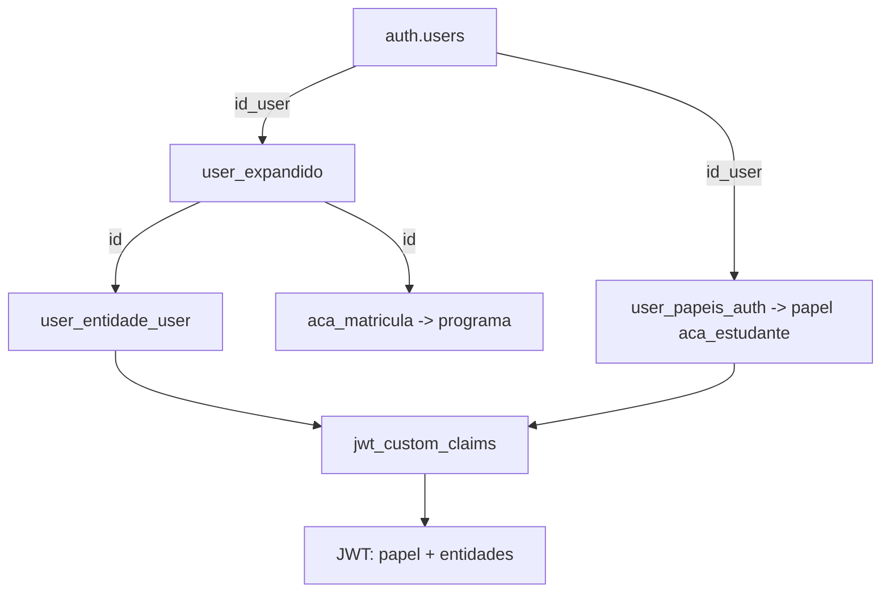

# Plano — Provisionar usuário de teste (Aluno e Docente)

> **Objetivo:** criar um **aluno** (e, na sequência, um **docente**) de teste para validar o lado do consumo do LMS (`/minhas_atividades`) e o Portal Docente (`/portal-docente/entregas`).
> **Para quem:** agente com MCP de banco (Supabase) — executar os SQLs na ordem.
> **Contexto:** os testes de gestor já foram feitos (Fase 2). Falta o teste como **aluno** — que ainda não existe — e como **docente**.
> **Data:** 2026-10-05.

---

## 0. Por que precisa de mais que "só uma matrícula"

O LMS do aluno roda RPCs `SECURITY INVOKER` que dependem de **RLS por claims do JWT**. Não basta criar a matrícula: sem o JWT com `papel = 'aca_estudante'` e `entidades = [<entidade>]`, o aluno não enxerga nada (ou erra 403).

Os claims vêm do Auth Hook **`public.jwt_custom_claims`**, disparado na emissão do token:

| Claim | De onde vem (SQL do hook) |
|---|---|
| `papel` | `user_papeis_auth.id_user = <auth uid>` JOIN `user_papeis` → `nome` (`LIMIT 1`) |
| `entidades` | `user_entidade_user.id_user = user_expandido.id` (onde `user_expandido.id_user = <auth uid>`) → array de `id_entidade` |

> ⚠️ **O hook só roda na emissão do token.** Depois de criar os registros, o usuário precisa **logar de novo** (ou refresh token) para os claims valerem.



---

## 1. O que um aluno precisa (5 registros)

| # | Tabela | Campos-chave | Observação |
|---|---|---|---|
| 1 | `auth.users` | `id`, `email`, `encrypted_password`, `email_confirmed_at` | usar a **Auth Admin API** (não inserir direto em `auth.users`) |
| 2 | `user_expandido` | `id_user` = auth uid, `email`, `nome_completo` | `id` é o "user_expandido_id" usado no resto |
| 3 | `user_papeis_auth` | `id_user` = **auth uid**, `id_papel` = id de `aca_estudante` | pode ter `id_entidade` (o hook ignora; usa o papel) |
| 4 | `user_entidade_user` | `id_user` = **user_expandido.id**, `id_entidade` | define o claim `entidades` |
| 5 | `aca_matricula` | `id_entidade`, `id_programa`, `id_usuario` = **user_expandido.id**, `status='ativa'` | a RPC do aluno valida a matrícula |

> Atenção às duas semânticas de `id_user`: em `user_papeis_auth` é o **auth uid**; em `user_entidade_user` é o **user_expandido.id**. (É assim mesmo no projeto.)

---

## 2. Pré-requisitos

- [ ] Entidade (ex.: ENSI) com o produto **`academico` ativo** em `entidade_produto` (senão o gate de produto bloqueia).
- [ ] Programa com conteúdos (**distribuídos** na Distribuição e/ou **associados** no Currículo).
- [ ] Permissões seedadas para `aca_estudante` (ilha Portal do Aluno) — já vêm da Fase A do multientidade.

Ids de referência (usados nos testes do gestor):
- Entidade: `00ca60ea-6667-482d-8a96-09b877707b08`
- Programa: `4c157c1f-e4d8-490b-b546-991ac81ab487`
- Papel `aca_estudante`: `b1dbb95a-c666-4f57-94dc-71d248ff17e5`

---

## 3. Passo a passo — ALUNO

### 3.1 Descobrir os ids (rodar e conferir)

```sql
-- Papel do aluno
select id, nome from public.user_papeis where nome = 'aca_estudante';

-- Entidade com produto acadêmico ativo
select e.id, e.nome_entidade, pr.slug
from public.user_entidades e
join public.entidade_produto ep on ep.id_entidade = e.id and ep.ativo
join public.produto pr on pr.id = ep.id_produto
where pr.slug = 'academico';

-- Programas da entidade (escolher um com conteúdos)
select p.id, p.descricao
from public.aca_programa p
where p.id_entidade = '00ca60ea-6667-482d-8a96-09b877707b08';
```

### 3.2 Criar o usuário no Auth

Preferir a **Auth Admin API** do Supabase (MCP/CLI), não INSERT direto:

```bash
# Supabase CLI/service-role
POST /auth/v1/admin/users
{ "email": "aluno.teste@educlick.dev", "password": "<senha>", "email_confirm": true }
```
→ guardar o `id` retornado como `<AUTH_UID>`.

### 3.3 Criar `user_expandido`

```sql
insert into public.user_expandido (id_user, email, nome_completo)
values ('<AUTH_UID>', 'aluno.teste@educlick.dev', 'Aluno Teste')
returning id;   -- guardar como <USER_EXP_ID>
```

### 3.4 Atribuir o papel `aca_estudante`

```sql
insert into public.user_papeis_auth (id_user, id_papel)
select '<AUTH_UID>', id from public.user_papeis where nome = 'aca_estudante'
on conflict do nothing;
```
> `id_user` = **AUTH_UID** (o hook casa por `auth uid`).

### 3.5 Vincular à entidade

```sql
insert into public.user_entidade_user (id_entidade, id_user)
values ('00ca60ea-6667-482d-8a96-09b877707b08', '<USER_EXP_ID>');
```
> `id_user` = **user_expandido.id**.

### 3.6 Criar a matrícula

Opção A — pela RPC (recomendado):
```sql
select public.aca_criar_matricula(
    p_id_entidade => '00ca60ea-6667-482d-8a96-09b877707b08',
    p_id_programa => '4c157c1f-e4d8-490b-b546-991ac81ab487',
    p_id_usuario  => '<USER_EXP_ID>'::uuid
);
```
Opção B — insert direto:
```sql
insert into public.aca_matricula (id_entidade, id_programa, id_usuario, status)
values ('00ca60ea-6667-482d-8a96-09b877707b08', '4c157c1f-e4d8-490b-b546-991ac81ab487', '<USER_EXP_ID>', 'ativa');
```

### 3.7 Entrar com o novo usuário

Fazer login em `/login` com `aluno.teste@educlick.dev` / `<senha>`. **Logar depois de criar os registros** (o hook emite os claims no login).

---

## 4. Verificação (SQL)

```sql
-- 1) as 5 peças existem e estão ligadas?
select
  (select count(*) from public.user_expandido where id = '<USER_EXP_ID>' and id_user = '<AUTH_UID>') as user_expandido_ok,
  (select count(*) from public.user_papeis_auth pa join public.user_papeis p on p.id = pa.id_papel
     where pa.id_user = '<AUTH_UID>' and p.nome = 'aca_estudante') as papel_ok,
  (select count(*) from public.user_entidade_user
     where id_user = '<USER_EXP_ID>' and id_entidade = '00ca60ea-6667-482d-8a96-09b877707b08') as entidade_ok,
  (select count(*) from public.aca_matricula
     where id_usuario = '<USER_EXP_ID>' and id_programa = '4c157c1f-e4d8-490b-b546-991ac81ab487' and status = 'ativa') as matricula_ok;
-- esperado: 1,1,1,1

-- 2) simular o que o hook vai colocar no JWT
select p.nome as papel
from public.user_papeis_auth pa join public.user_papeis p on p.id = pa.id_papel
where pa.id_user = '<AUTH_UID>' limit 1;                       -- esperado: aca_estudante

select jsonb_agg(ueu.id_entidade)
from public.user_entidade_user ueu
join public.user_expandido ue on ue.id = ueu.id_user
where ue.id_user = '<AUTH_UID>';                               -- esperado: ["00ca60ea-..."]
```

**No app:** `/minhas_atividades` deve listar o programa e a árvore de conteúdos; abrir um conteúdo marca progresso; responder uma atividade/avaliação grava submissão.

---

## 5. Variante — DOCENTE (Portal Docente)

Mesma base, trocando o papel e adicionando o vínculo de docente:

1. **Auth + `user_expandido`** iguais (passos 3.2/3.3).
2. **`user_papeis_auth`** com `id_papel` = `aca_docente` (`69c112b1-4ff9-4e49-ac41-86fd5bf503ad`).
3. **`user_entidade_user`** (passo 3.5).
4. **`aca_docente`** — cria o vínculo docente da entidade:
   ```sql
   insert into public.aca_docente (id_entidade, id_user_expandido, ativo)
   values ('00ca60ea-6667-482d-8a96-09b877707b08', '<USER_EXP_ID>', true)
   on conflict (id_entidade, id_user_expandido) do update set ativo = true
   returning id;   -- <DOCENTE_ID>
   ```
5. **Lecionar** (para ver conteúdos do programa que não criou): via `/atribuicao` — vínculo `aca_docente_modulo_componente_ciclo`.
6. Login → `/portal-docente/entregas`: deve ver **conteúdos que ele criou** (corrigíveis) e os do programa que leciona (🔒 leitura).

> Se o objetivo é só testar **corrigir**, o docente precisa ter **criado** um conteúdo (via Programação de Atividades) com entregas.

---

## 6. Observações de RLS / segurança (registrar)

- As policies de aluno (`20260806100005`) exigem `lms_usuario_eh_estudante()` (**`papel = 'aca_estudante'`**) **e** `lms_usuario_pertence_entidade()` (**claim `entidades`**). Se qualquer um faltar, o aluno não vê conteúdo.
- ⚠️ **Dívida de segurança:** `lms_usuario_eh_gestor()` é `papel = 'admin' OR papel LIKE 'aca_%'`. Como `aca_estudante` casa com `aca_%`, **o aluno também passa nas policies de gestor** das tabelas `lms_*` (pode ler/escrever via PostgREST direto, fora das RPCs). Já está anotado como Fase E em `dividas-multitenant.md`; aqui serve de alerta ao testar.
- O JWT é cacheado: alterar papel/entidade **sem** novo login não reflete (resolver com re-login/refresh).

---

## 7. Limpeza (remover o usuário de teste)

```sql
-- ordem importa (FKs)
delete from public.aca_matricula   where id_usuario = '<USER_EXP_ID>';
delete from public.user_entidade_user where id_user = '<USER_EXP_ID>';
delete from public.user_papeis_auth   where id_user = '<AUTH_UID>';
delete from public.user_expandido     where id = '<USER_EXP_ID>';
-- por último, remover o usuário no Auth (Admin API): DELETE /auth/v1/admin/users/<AUTH_UID>
```

---

## 8. Checklist para o agente (MCP)

- [ ] Conferir papel `aca_estudante`, entidade com produto `academico`, programa com conteúdos.
- [ ] Criar usuário no Auth (API admin) e guardar `<AUTH_UID>`.
- [ ] Inserir `user_expandido` → `<USER_EXP_ID>`.
- [ ] Inserir `user_papeis_auth` (id_user = AUTH_UID, papel = aca_estudante).
- [ ] Inserir `user_entidade_user` (id_user = USER_EXP_ID, entidade).
- [ ] Criar `aca_matricula` (programa, USER_EXP_ID, status ativa).
- [ ] Rodar a verificação da seção 4 (esperado 1,1,1,1).
- [ ] Logar no app **após** criar tudo e validar `/minhas_atividades`.
- [ ] (Opcional) repetir a variante docente (seção 5).
- [ ] Reportar `<AUTH_UID>`, `<USER_EXP_ID>`, email e senha usados (e o id da matrícula).

---

## 9. Referências

- `documentacao/planos/a_fazer/testes_lms_fase_2.md` — roteiro de testes (pré-requisitos e itens do aluno).
- `documentacao/paginas/minhas_atividades.md` — consumo do aluno.
- `documentacao/arquitetura/permissoes.md` — modelo de papel/entidade e hook de JWT.
- `documentacao/planos/a_fazer/dividas-multitenant.md` — dívida da RLS por papel (Fase E).
